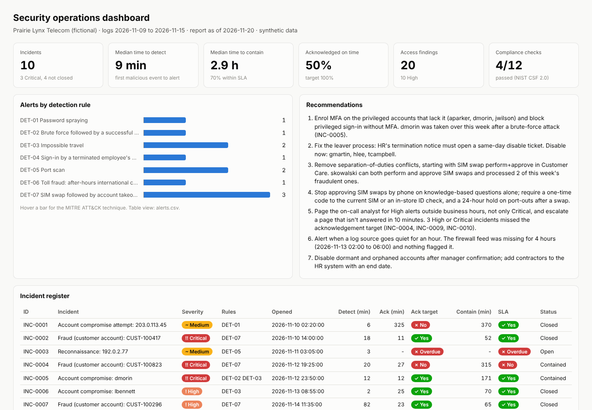

# Telecom Security Operations Lab

A one-week security operations exercise for a fictional Saskatchewan telecom: access management review, seven detection rules mapped to MITRE ATT&CK, an incident register with response targets, compliance checks against NIST CSF 2.0, a written fraud investigation and a management brief. It covers corporate IT, IP networks, voice (toll fraud) and customer accounts (SIM swap fraud).

Scope note: This is a learning project. The company ("Prairie Lynx Telecom"), people, customers and events are all synthetic, generated by `generate_data.py`. IP addresses come from private (RFC 1918) and documentation (RFC 5737) ranges. Nothing was scanned or attacked.

## Results at a glance

| | |
|---|---|
| Data | 135 accounts; 9,779 log events over 7 days (958 sign-ins, 5,752 firewall events, 1,429 calls, 1,640 customer account events) |
| Detection | 7 rules, 11 alerts grouped into 10 incidents (3 Critical). Every alert is a planted attack; the 3 planted look-alikes (a real business trip, a legitimate overseas call, a late password reset) stayed quiet |
| Response | Median 9 min to detect, 27 min to acknowledge, 2.9 h to contain; 50% acknowledged on target, 70% contained within SLA, 1 overdue |
| Access review | 20 findings (10 High): 3 leavers still enabled, 3 privileged accounts without MFA, 3 separation-of-duties conflicts, 8 dormant accounts, 1 orphaned contractor account |
| Compliance | 4 of 12 checks passed against the access management standard (NIST CSF 2.0) |
| Tests | 46 pytest tests; GitHub Actions runs them and the strict data checks on every push |



Full-page screenshot: [docs/screenshots/dashboard-full.png](docs/screenshots/dashboard-full.png)

## Detection rules

| Rule | Detects | MITRE ATT&CK | Alerts |
|---|---|---|---|
| DET-01 | Password spraying (one IP, 10+ accounts, 30 min) | T1110.003 | 1 |
| DET-02 | Brute force followed by a successful sign-in | T1110.001 | 1 |
| DET-03 | Impossible travel to a new location | T1078 | 2 |
| DET-04 | Sign-in by a terminated employee's account | T1078 | 1 |
| DET-05 | Port scan (25+ ports, 5 min), internal or external | T1046 | 2 |
| DET-06 | Toll fraud: after-hours international calling from one extension | T1496 | 1 |
| DET-07 | SIM swap followed by account takeover within 24 hours | T1451 (Mobile) | 3 |

Logic, thresholds, false positives and the response playbook for each: [docs/detection-catalogue.md](docs/detection-catalogue.md).

## Documents

| File | What it is |
|---|---|
| [docs/security-brief.pdf](docs/security-brief.pdf) | Two-page management brief: what happened, incidents, access review, compliance, recommendations |
| [docs/investigation-sim-swap-fraud.md](docs/investigation-sim-swap-fraud.md) | Investigation of three SIM swap account takeovers: timelines with event IDs, findings, conclusion, recommendations, evidence handling |
| [docs/access-management-standard.md](docs/access-management-standard.md) | The standard the access review and compliance checks test against (AM-01 to AM-08, IR-01 to IR-04) |
| [docs/detection-catalogue.md](docs/detection-catalogue.md) | Every rule: logic, threshold, ATT&CK mapping, false positives, playbook |
| [docs/methodology.md](docs/methodology.md) | Data, pipeline, severity, response targets, how each measure is calculated, limits |
| [docs/security-awareness-sim-swap.md](docs/security-awareness-sim-swap.md) | Awareness bulletin for Customer Care and store staff |
| [reports/security_summary.md](reports/security_summary.md) | KPIs, incidents, findings, compliance and recommendations (generated) |
| [reports/dashboard.html](reports/dashboard.html) | The dashboard above (generated) |
| `reports/*.csv` | Alerts, incidents, access review findings and compliance results (generated) |

## Repository layout

```
generate_data.py            Builds the synthetic data set (fixed seed, same files every run)
run_lab.py                  Runs everything and writes reports/
data/
  users.csv                 Directory export: status, MFA, last sign-in
  hr_roster.csv             HR records with termination dates
  entitlements.csv          Who holds which permission
  sod_rules.csv             Separation-of-duties pairs
  auth_log.csv              Sign-ins with geolocation
  firewall_log.csv          Edge and internal firewall events
  voip_cdr.csv              Call detail records
  extensions.csv            Phone extensions
  customer_events.csv       SIM swaps, password resets, port-outs and other account changes
  incident_updates.csv      Analyst actions on each incident (the ticket history)
secops/
  checks.py                 Data quality checks
  access_review.py          Directory vs HR vs entitlements
  detections.py             The seven rules
  incidents.py              Grouping alerts into incidents; response times and SLAs
  compliance.py             12 checks mapped to NIST CSF 2.0
  metrics.py                Loads results into SQLite and runs the named queries
  reports.py                CSV, Markdown and HTML output
  config.py                 Thresholds, SLAs, rule metadata
sql/
  schema.sql                Tables for alerts, incidents, findings and compliance
  metrics.sql               Named queries behind every report table
tests/                      46 pytest tests
.github/workflows/checks.yml
```

## How it works

1. **Data checks.** `run_lab.py` validates every file first: columns, timestamps, IP addresses, ports, permission names, a directory export that isn't older than the sign-in log, and analyst updates that point at real incidents and only move forward. `--strict` fails the run on any problem.
2. **Detection.** Each rule reads one log source (two for DET-04) and raises an alert at the next 5-minute run after its threshold is crossed. Severity goes up for privileged accounts, internal scanners, port-outs and device orders, and large toll fraud losses.
3. **Incidents.** Alerts about the same user, IP, extension or customer within 24 hours become one incident. Response times come from the analyst updates and are measured against acknowledge and contain targets by severity.
4. **Access review and compliance.** The directory is compared with HR and the entitlement list, then 12 checks score the results against the access management standard and NIST CSF 2.0, each with measured value, target and evidence.
5. **Reporting.** Results are loaded into an in-memory SQLite database; the named queries in `sql/metrics.sql` build the Markdown summary, the HTML dashboard and the CSV exports.

## Run it

Python 3.9 or newer. The lab only uses the standard library; pytest is needed for the tests.

```bash
git clone https://github.com/manthanray03/telecom-security-operations-lab.git
cd telecom-security-operations-lab

python3 run_lab.py --as-of 2026-11-20 --strict   # leave out --as-of to report as of today
open reports/dashboard.html                      # macOS; use xdg-open on Linux
```

Rebuild the data (gives the same files):

```bash
python3 generate_data.py
```

Tests:

```bash
python3 -m venv .venv && source .venv/bin/activate
pip install -r requirements.txt
python -m pytest
```

To try your own thresholds, edit `secops/config.py` and run `run_lab.py` again.

## Frameworks

- MITRE ATT&CK (Enterprise and Mobile)
- NIST Cybersecurity Framework (CSF) 2.0: PR.AA (identity and access), DE.CM and DE.AE (monitoring and analysis), RS.MA and RS.MI (incident management and mitigation)

## Author

Manthan Ray, Regina, SK. [LinkedIn](https://linkedin.com/in/manthanray)
